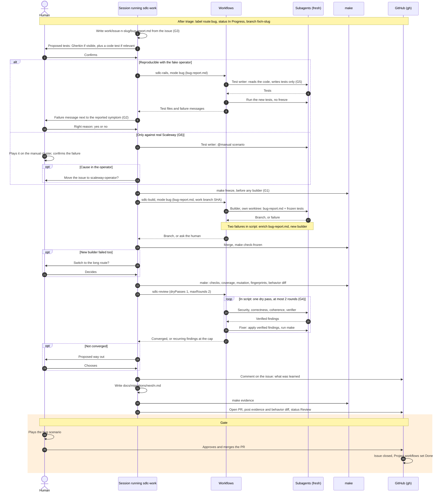

# Intermediate process (bug): sequence diagram

No spec, no plan. Bug tests are frozen before any builder (bug G1), which supersedes `decisions.md`. The building blocks and the start and resume sequence are described in `sequence-long-process.md`.

Corrected on 2026-10-18 with the simulation [`simulation-bug.md`](../../planning-artifacts/plans/plan-sdlc-process-2026-10-18/simulation-bug.md) (gap IDs G*n*). The version simulated is in commit `081611a`. Stages without human interaction then moved to saved dynamic workflows (participant "Workflows"; see the plan decisions).

