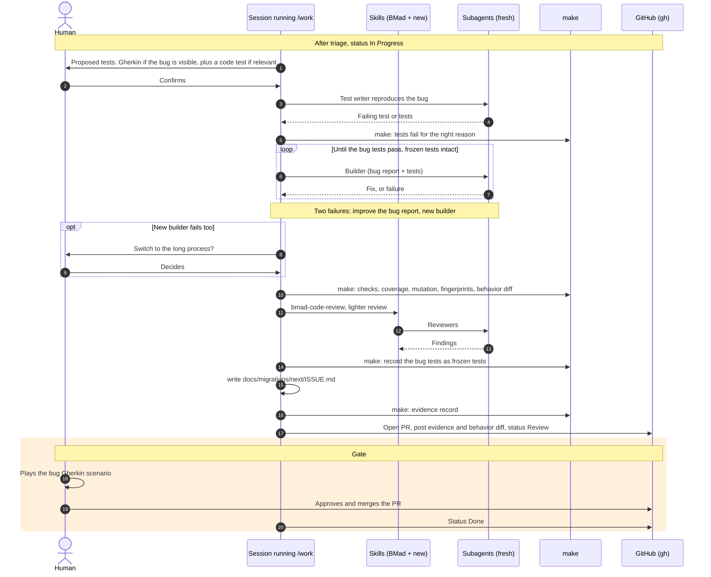

# Intermediate process (bug): sequence diagram

No spec, no plan. The building blocks and the start and resume sequence are described in `sequence-long-process.md`.

## Test rules

- Bug visible in the UI: a Gherkin scenario, plus a code test when relevant (the agent proposes, the human confirms).
- Invisible bug: a code test only.
- Once the bug is fixed, its tests join the frozen tests, with their fingerprint recorded.
