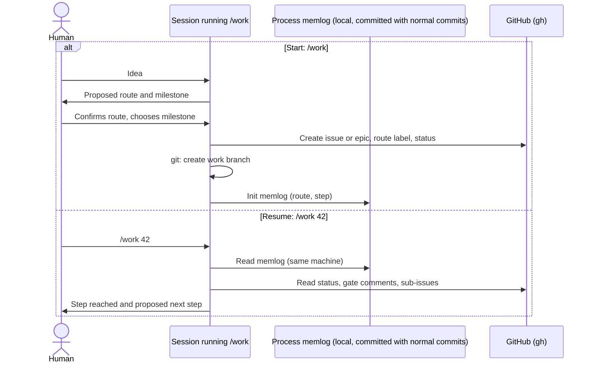
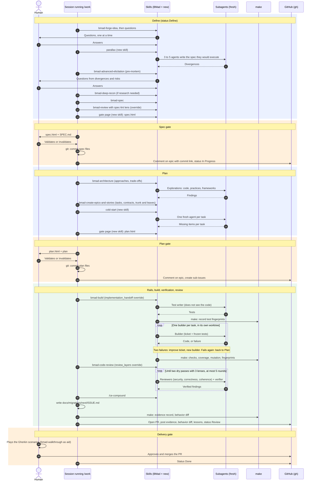

# Long process: sequence diagram

The human's Claude session runs the `/work` orchestrator. `/work` calls existing BMad skills (some with overrides in `_bmad/custom/`) and new skills of the custom module; skills start fresh subagents; `make` runs the deterministic checks; `gh` writes to GitHub. Skill and override assignments are a base to confirm at implementation.

## Building blocks

| Block | What it is | Talks with the human |
| --- | --- | --- |
| Session | The Claude conversation the human starts | Yes |
| Skill | Instructions loaded by the session, which then plays that role | Yes (it is the session) |
| Subagent | An agent started with a fresh context; works alone and returns a report | No |
| Command | A tool without AI: `make`, `git`, `gh` | No |

## Start and resume

On another machine the memlog is available only once committed; otherwise `/work` resumes from the last gate recorded on GitHub.

## Long process

## Open questions

- Whether each override is enough, or a new skill is needed instead.
- Exact names of the new skills and of the custom module.
