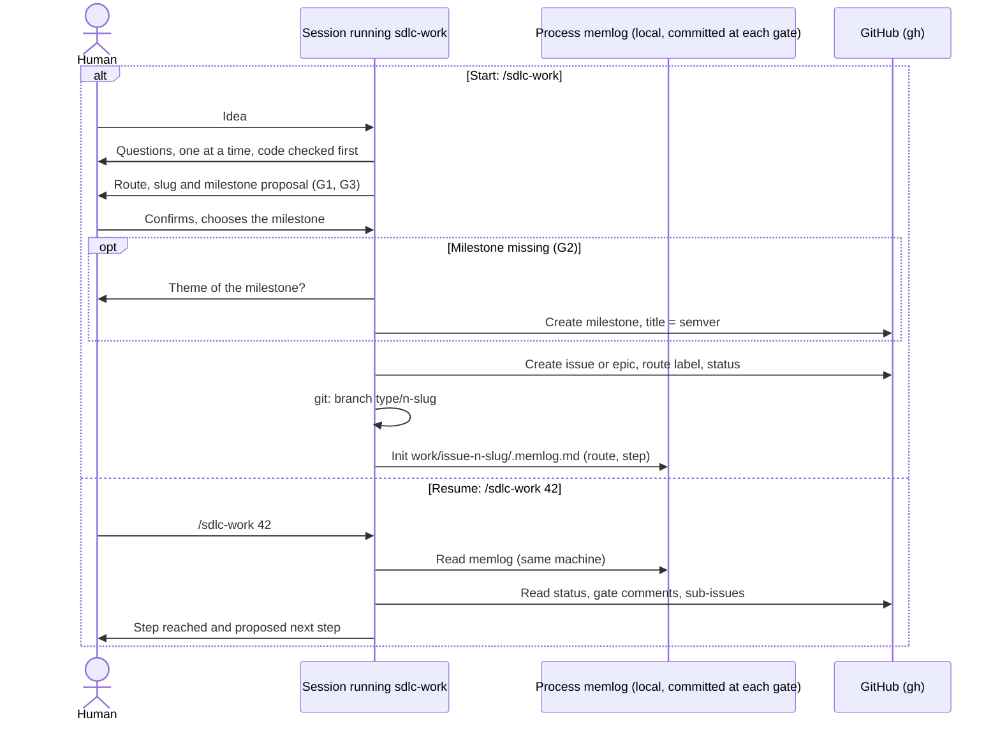
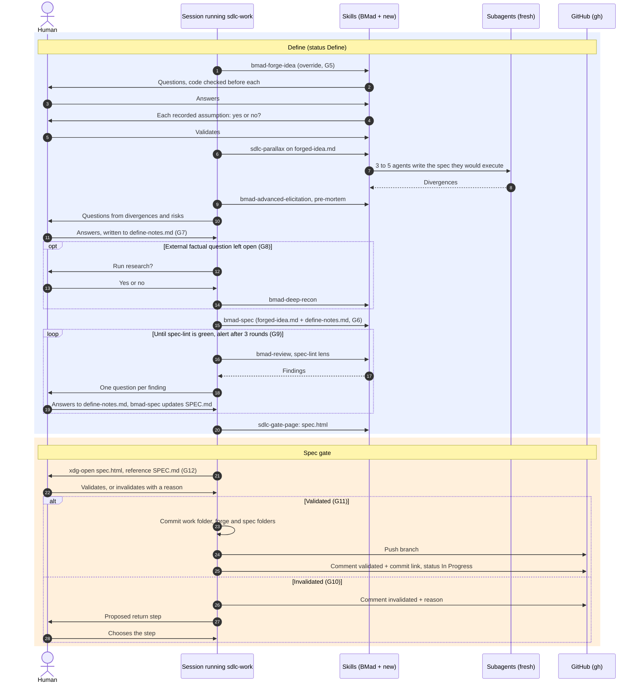
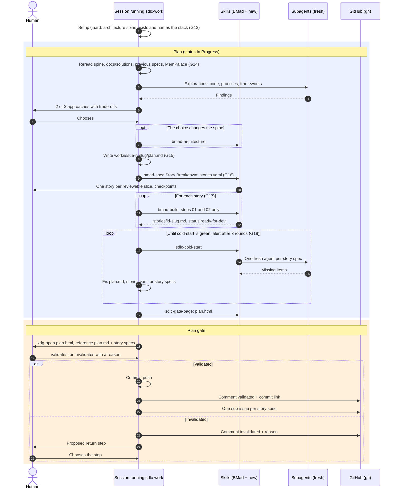
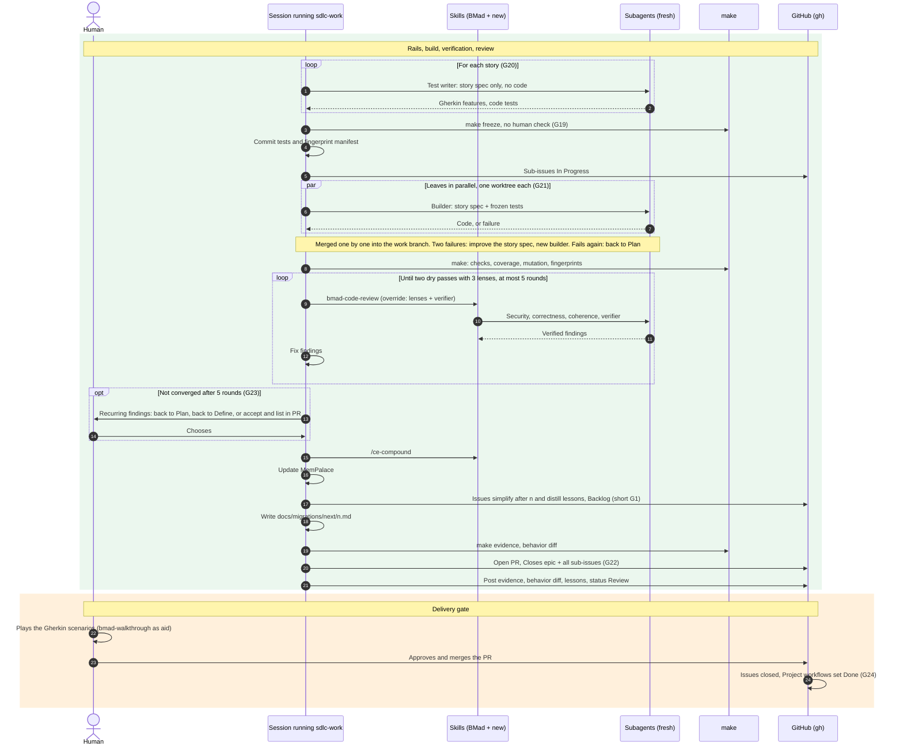

# Long process: sequence diagram

The human's Claude session runs the `sdlc-work` orchestrator. `sdlc-work` calls existing BMad skills (some with overrides in `_bmad/custom/`) and new skills of the custom module; skills and `sdlc-work` start fresh subagents; `make` runs the deterministic checks; `gh` writes to GitHub.

Corrected on 2026-10-18 with the simulation [`simulation-long.md`](../../planning-artifacts/plans/plan-sdlc-process-2026-10-18/simulation-long.md) (gap IDs long G*n*) and [`simulation-short.md`](../../planning-artifacts/plans/plan-sdlc-process-2026-10-18/simulation-short.md) (short G*n*). The version simulated is in commit `081611a`. Every skill called by `sdlc-work` writes its result to the process memlog and hands control back through its `on_complete` override (long G4).

## Building blocks

| Block | What it is | Talks with the human |
| --- | --- | --- |
| Session | The Claude conversation the human starts | Yes |
| Skill | Instructions loaded by the session, which then plays that role | Yes (it is the session) |
| Subagent | An agent started with a fresh context; works alone and returns a report | No |
| Command | A tool without AI: `make`, `git`, `gh` | No |

## Start and resume

On another machine the memlog is available from the last gate commit; otherwise `sdlc-work` resumes from the last gate recorded on GitHub.

## Define and spec gate

## Plan and plan gate

## Rails, build, review, delivery gate

