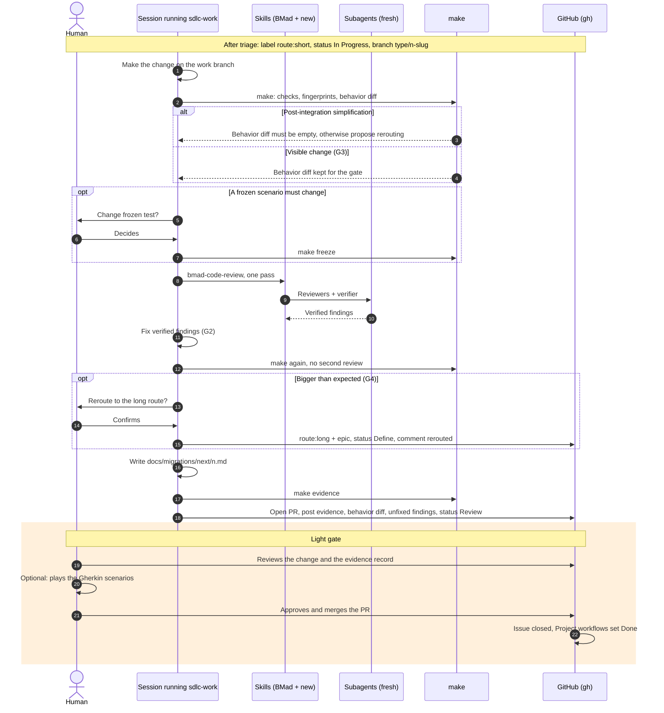

# Short process: sequence diagram

For example a typo, or a code simplification after integration. The building blocks and the start and resume sequence are described in `sequence-long-process.md`.

Corrected on 2026-10-18 with the simulation [`simulation-short.md`](../../planning-artifacts/plans/plan-sdlc-process-2026-10-18/simulation-short.md) (gap IDs G*n*). The version simulated is in commit `081611a`.

