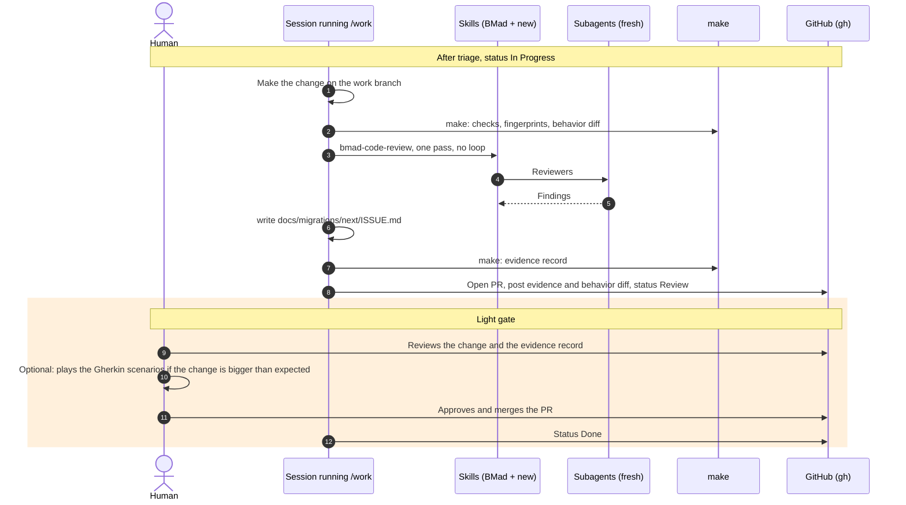

# Short process: sequence diagram

For example a typo, or a code simplification after integration. The building blocks and the start and resume sequence are described in `sequence-long-process.md`.

## Conditions

- A code simplification after integration goes through this process only if the frozen tests stay green and the behavior diff is empty.
- Work that turns out bigger than expected is rerouted to the long process.
