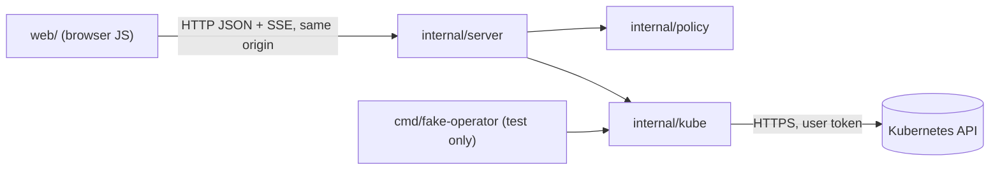
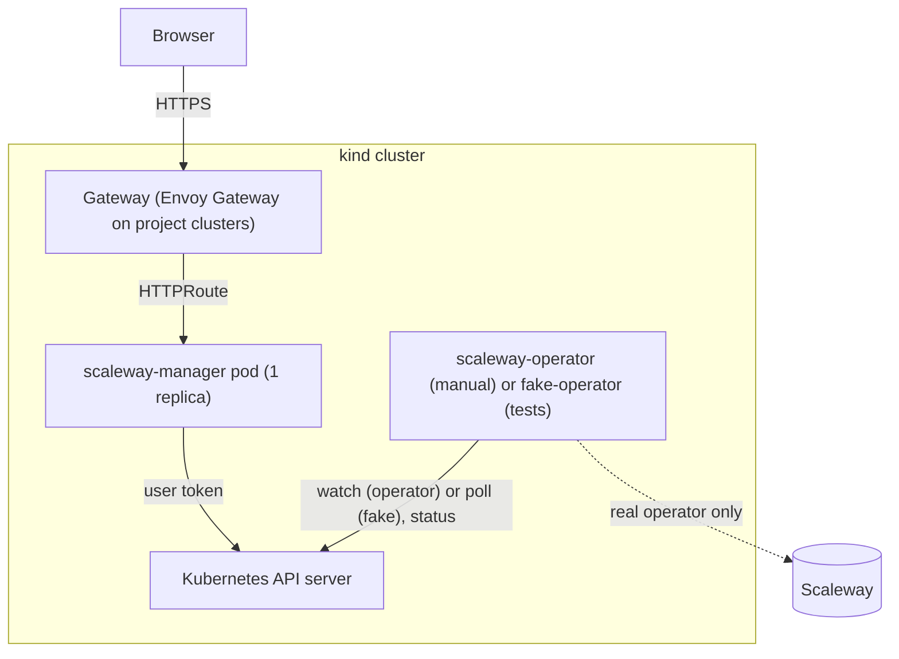

# Architecture Spine: scaleway-manager

## Design Paradigm

Ports and adapters. The core holds the project policy as pure functions over Kubernetes objects and imports no adapter. Adapters sit at the edges: the HTTP server that faces the browser, and the Kubernetes API client. Everything uses only the Go standard library and the native browser platform.

| Layer | Package / directory | Holds |
| --- | --- | --- |
| Core (policy) | `internal/policy` | Reserved namespaces, managed-namespace predicate, edit rules, immutable fields, export and re-import shaping, policy error codes |
| Port + adapter (outbound) | `internal/kube` | The only Kubernetes HTTPS client: URL building, per-request token, CRUD, merge patch, status subresource, watch |
| Adapter (inbound) | `internal/server` | Routes (`net/http.ServeMux`), sessions, cross-origin protection, SSE relay, embedded page |
| Browser | `web/` | ES modules, custom elements, served as written through `go:embed` |
| Test-only | `cmd/fake-operator`, `internal/kube/kubetest` | Fake operator; shared fake Kubernetes API server for Go tests |



`internal/policy` imports neither `internal/server`, `internal/kube` nor anything outside the standard library.

## Invariants & Rules

### AD-1: Shipped code has zero runtime dependency [ADOPTED]

- **Binds:** all
- **Prevents:** a framework or library entering the shipped server or page, one convenience at a time.
- **Rule:**
  - The server and the fake operator use only the Go standard library, and `go.mod` has no `require` directive.
  - The page uses only the browser platform: no third-party script, no CDN, no bundler output.
  - Test, lint and build tools are allowed at pinned versions, outside `go.mod` and outside `web/`.
  - A check fails the build when `go.mod` gains a `require`. The `Content-Security-Policy` of AD-8 blocks any asset not served by the binary.

### AD-2: One outbound peer, one URL builder [ADOPTED]

- **Binds:** `internal/kube`, `internal/server`, `cmd/fake-operator`
- **Prevents:**
  - a unit calling Scaleway;
  - browser input reaching another Kubernetes path, for example through `%2F` in a name;
  - two units building Kubernetes URLs differently.
- **Rule:**
  - The only outbound calls go to the Kubernetes API server, through `internal/kube`. No code calls the Scaleway API.
  - The API address comes from `KUBERNETES_SERVICE_HOST`/`KUBERNETES_SERVICE_PORT`, and the CA comes from the mounted `kube-root-ca.crt` ConfigMap.
  - One function in `internal/kube` builds every request URL. It takes the group, version and resource from a closed list:
    - the four operator kinds;
    - `namespaces`;
    - `secrets`: create and replace; read as metadata only (AD-14);
    - `apiextensions.k8s.io/customresourcedefinitions`, `get` only;
    - `apps/v1` `deployments`, `list` only, for the AD-9 startup guard of the fake operator;
    - the discovery and review endpoints the readiness screen needs.
  - Namespace and name must pass DNS-1123 validation, and each path segment goes through `url.PathEscape`. No browser query parameter is forwarded as is.

### AD-3: Every Kubernetes call carries the logged-in user's token [ADOPTED]

- **Binds:** `internal/server`, `internal/kube`, chart
- **Prevents:** the UI acting with more rights than its user; token leaks; cross-site requests acting as the user.
- **Rule:**
  - **Login:** the user pastes a Kubernetes bearer token (`kubectl create token`). It is sent only in the body of the login `POST`, never in a URL.
  - **Session:** the server keeps the token in an in-memory session. The session is identified by a random ID from `crypto/rand`, carried in a `__Host-` cookie that is `HttpOnly`, `Secure`, `SameSite=Strict` and `Path=/`. Every Kubernetes call for that user sends that token. Each session has a context, and every in-flight request and watch of the session derives from it.
  - **Token type:** in Go the token is a `kube.Token` type whose `String`, `GoString`, `LogValue` and `MarshalJSON` redact it.
  - **Never exposed:** no request or response body, no `Authorization` header and no `Cookie` header is logged. The token never reaches the browser or the disk.
  - **Session end:** logout, a Kubernetes `401`, or the session's idle or absolute timeout ends the session. Ending it cancels the session context, which closes its stream and watches, and sends the user back to login. A `403` is shown to the user. Sessions do not survive a pod restart.
  - **Pod account:** no impersonation. The pod runs with `automountServiceAccountToken: false`. Its own account is never used for user actions.
  - **Cross-site protection:** every non-`GET` route, login included, is wrapped in `http.CrossOriginProtection` and accepts only `application/json` bodies. This is CSRF protection, not a deletion safeguard. Deletion stays unconfirmed.

### AD-4: Custom resources stay raw JSON; writes are merge patches at the version seen

- **Binds:** `internal/kube`, `internal/policy`, `internal/server`, `web/`
- **Prevents:**
  - a typed Go struct dropping or reshaping an unknown field;
  - a form overwriting changes it never saw;
  - the `Synced` check racing the write.
- **Rule:**
  - **Reading:** CRs are read and passed as raw JSON (`json.RawMessage`, or `map[string]any` decoded with `UseNumber`). A Go struct may describe a field the code reads, but it is never re-encoded in place of the object.
  - **Writing:** every update is a JSON merge patch (`application/merge-patch+json`). It holds only the fields the user edited, plus `metadata.resourceVersion` of the object shown to the user.
  - **Edit check:** the server applies the edit rules of AD-6 to the object at that `resourceVersion`.
  - **Conflicts:** a `409` is returned as error code `conflict`, with no retry and no re-base.
  - **Status:** only the fake operator writes `status`, through the status subresource.

### AD-5: Export and re-import are JSON, built by `internal/policy` [ADOPTED]

- **Binds:** export, re-import, `web/`
- **Prevents:** duplicates in Scaleway after re-import; a Secret leaking into a file; re-import overwriting live objects.
- **Rule:**
  - **Scope:** an export covers one managed namespace (AD-6).
  - **Format:** one JSON `v1` `List`, which `kubectl apply -f` accepts. Items come in this order:
    1. the `Namespace`;
    2. its `NamespaceRole`;
    3. its `ScalewaySecret`, `Instance` and `LoadBalancer` CRs.
  - **Kept fields:** each item keeps exactly these fields, unchanged:
    - `apiVersion`, `kind`;
    - `metadata.name`, plus `metadata.namespace` for namespaced items;
    - `metadata.labels`;
    - `metadata.annotations`, except those prefixed `kubectl.kubernetes.io/` or `fake.scaleway-manager.test/`;
    - `spec`.

    Everything else is dropped. The `Namespace` keeps its `scaleway.mathieubodin.io/project-id` annotation.
  - **Annotations added to the exported `Namespace`:**
    - `scaleway-manager.mathieubodin.io/export-format: "1"`;
    - `scaleway-manager.mathieubodin.io/required-secrets`, a JSON array of the Secret names that the `ScalewaySecret` CRs reference.
  - **No Secrets:** an export never contains a `Secret` object.
  - **Re-import:**
    - accepts only format `"1"`;
    - unwraps the `List` server-side and creates each item in file order with `POST`;
    - never updates an existing object: it reports `already-exists` and continues;
    - rejects any `Secret` item and any kind outside the AD-2 list;
    - returns one result per item: `created`, `already-exists`, or the error envelope of AD-13.
  - **Tests:** one test in `internal/policy` lists the kept fields.

### AD-6: Policy lives in `internal/policy`; the server enforces it; the page mirrors it from one module [ADOPTED]

- **Binds:** `internal/policy`, `internal/server`, `web/`
- **Prevents:** a rule that exists only in the browser; two drifting copies of a rule; two definitions of a managed namespace.
- **Rule:**
  - **Reserved namespaces:** `default`, `kube-system`, `kube-public`, `kube-node-lease` and `scaleway-system` never hold a Scaleway CR. No `NamespaceRole` may target them. The UI may still write the credential Secrets into `scaleway-system` when it fills gaps.
  - **Managed namespace:** a namespace manages a Scaleway project if and only if it carries a UUID `scaleway.mathieubodin.io/project-id` annotation. One `internal/policy` function decides this. One server action creates or annotates namespaces.
  - **Edit rule:** `Instance`, `LoadBalancer` and `ScalewaySecret` can be updated only when `status.sync_state` is `Synced`. A `NamespaceRole` can always be updated, because the operator only reads it and never writes its status.
  - **Immutable fields after creation:**
    - `Instance` and `LoadBalancer`: `spec.zone` and `spec.name`;
    - `ScalewaySecret`: `spec.region` and `spec.name`;
    - `NamespaceRole`: `spec.namespace`, which must equal `metadata.name`.
  - **No safeguard:** deletion has no confirmation and no safeguard. The UI lists only objects that exist as CRs.
  - **Page mirror:** the page mirrors these rules only in `web/policy.js`. `web/policy.js` and `internal/policy` pass the same fixture table in `internal/policy/testdata/`. Its field paths use the operator's JSON names, which are snake_case (`sync_state`, `error_message`, `instance_type`), never the CRD printer-column paths.

### AD-7: One live-update stream per page load, with a fixed event contract

- **Binds:** `internal/server`, `web/`, chart
- **Prevents:** each component opening its own stream or polling; units disagreeing on event shape, initial state or recovery.
- **Rule:**
  - **One stream:** each page load opens one `EventSource` on `/api/events`. A shared module `web/events.js` dispatches its events, and components never open streams or poll.
  - **Watches:** the server watches with the user's token. `namespaces` and `namespaceroles` are watched cluster-wide. `Instance`, `LoadBalancer` and `ScalewaySecret` are watched per managed namespace. Secrets are never watched: their existence is checked by name on demand. A `403` on one namespace's watch sends `event: forbidden`, whose data is the AD-13 envelope plus `"namespace"` and `"resource"`, and the stream continues.
  - **Message shape:**
    - `event:` is the resource plural;
    - `data:` is `{"type":"ADDED|MODIFIED|DELETED","object":{…}}`;
    - `id:` is the object's `resourceVersion`.
  - **Opening:** the stream opens with a synthetic `ADDED` per existing object, then `event: synced`.
  - **Recovery:** after a watch `410 Gone`, the server re-lists and sends `event: synced` again. Any other watch error, or a `401`, sends `event: error` with the AD-13 envelope, then closes the stream.
  - **Timeout:** the chart's `HTTPRoute` rule for `/api/events` sets `timeouts.request: 0s` so the Gateway does not cut the stream.

### AD-8: Browser code is native ES modules, rendered safely [ADOPTED]

- **Binds:** `web/`, `internal/server`
- **Prevents:** a build step or framework creeping in; script injection from cluster data, which could delete infrastructure; elements Playwright cannot reach.
- **Rule:**
  - **No build step:** `web/` holds only the shipped HTML, CSS and ES modules, served as written. Their tests live in `tests/web/`. Types are JSDoc comments checked by `tsc --checkJs --noEmit`.
  - **Rendering:** cluster data enters the DOM only through `textContent`, `setAttribute` or element properties, never through `innerHTML`.
  - **Headers:** every response carries `Content-Security-Policy: default-src 'self'; base-uri 'none'; form-action 'self'; frame-ancestors 'none'` and `X-Content-Type-Options: nosniff`.
  - **Elements:** custom elements are named `smgr-<noun>` and use no shadow root or an open one. Every interactive element has an accessible name.
  - **Routing:** in-page routing uses the URL hash.

### AD-9: The fake operator mimics the real lifecycle, for tests only [ADOPTED]

- **Binds:** `cmd/fake-operator`, `internal/kube`, `tests/cluster/fake-operator/`, test cluster, Gherkin scenarios
- **Prevents:** tests passing against behavior the real operator never has; Gherkin steps faking status their own way; a cause forced on a kind that cannot have it; fake status written next to the real operator.
- **Rule:**
  - **Contract:** the release `scaleway-operator-v0.1.15` with its CRD chart `scaleway-operator-crds` `0.1.14`, the version AD-10 pins. The fake copies, kind by kind:
    - status field names and Rust defaults;
    - `sync_state` values and messages;
    - when the finalizer is added or kept.

    The finalizers are `scaleway.mathieubodin.io/instance-finalizer`, `…/loadbalancer-finalizer` and `…/secret-finalizer`. Moving to another operator release means reviewing the fake. Kinds not in that release (such as `RDB`) are out of scope.
  - **Where it runs:**
    - `cmd/fake-operator` is a Go controller. Its own `cmd/fake-operator/Dockerfile`, on the release bases and checked by `scripts/check-dockerfile.sh`, is built by `make build-fake-operator-image` as `scaleway-manager-fake-operator:local`.
    - That image is never pushed. The Deployment uses `imagePullPolicy: Never`.
    - Its manifests are raw Kubernetes manifests written as JSON (valid YAML, read by Go tests with the standard library) under `tests/cluster/fake-operator/`: namespace `fake-operator`, ServiceAccount, ClusterRole, ClusterRoleBinding, Role, RoleBinding, Deployment.
    - It runs only in the automated-test kind cluster. A test fails if the release `Dockerfile`, `charts/` or the release workflow mention it.
    - At start, it exits 1 if a Deployment labelled `app.kubernetes.io/name: scaleway-operator` exists in `scaleway-system`.
  - **Identity:**
    - `internal/kube` never reads a token itself: each call receives one. This holds for the server (AD-3) and for the fake.
    - The fake's Deployment sets `automountServiceAccountToken: false` and mounts an explicit projected volume (token and `kube-root-ca.crt`) at `/var/run/secrets/kubernetes.io/serviceaccount`.
    - The fake rereads the token at each pass.
    - RBAC:
      - `get` and `list` on `namespaces` and `namespaceroles`;
      - `list` and `patch` on the three other kinds and on their `/status`;
      - in `scaleway-system` only, `list` on `deployments`.

      The fake has no access to Secrets.
  - **Lifecycle:** the fake polls every `FAKE_OPERATOR_STEP_DELAY` (a Go duration, default `2s`) and moves each object at most one step per pass, in the operator's order:
    1. **Deletion first:** the preconditions are skipped, except the region check of a `ScalewaySecret`. The fake removes the finalizer, except under `Error` or `Locked`. A refused cause never blocks a deletion.
    2. **Finalizer:** only the finalizer is written, with no status.
    3. **`Syncing`**, then **`Synced`** on the next pass. A `ScalewaySecret` writes both in one pass, as the operator does.
  - **How it writes:**
    - The finalizer goes by merge patch on the object, with the whole list.
    - Status goes by merge patch on `/status`, with the whole struct; `null` removes a key. Neither patch carries a `resourceVersion`.
    - The fake patches only when the result differs from what it read, and it keeps the values it generated. A steady object therefore keeps its `resourceVersion`, and a UI edit does not get `409` (AD-4).
    - It writes nothing on `NamespaceRole`, and no annotation, label or event.
  - **Checks it mimics:** each in the operator's order, with the operator's message, from what the fake can read (the spec, namespaces, `NamespaceRole`):
    - a missing `NamespaceRole` named after the namespace;
    - a read-only role (other than `Editor`, `Admin` or `OrganizationOwner`) while nothing is created yet;
    - the `scaleway.mathieubodin.io/project-id` annotation (a UUID for `Instance` and `LoadBalancer`);
    - the zone, instance type, `lb_type` and region lists;
    - a `ScalewaySecret` with no `spec.source.kubernetes_secret`.

    A spec-list failure writes no status, as the operator does. A `spec` change of a synced `ScalewaySecret` (`metadata.generation` ≠ `observed_generation`) pushes a new version.
  - **Not mimicked:**
    - checks on Secrets the fake cannot read: the source Secret, its opt-in and key, and `scaleway-ns-creds-<ns>`;
    - `last_synced_resource_version`;
    - `FinalizerRemovedWithoutScalewayDelete`;
    - the operator's circuit breaker.

    A scenario stands for a Secret failure with the `Error` cause and the operator's message. The real behavior is covered by `@manual` scenarios.
  - **Causes:** `fake.scaleway-manager.test/outcome` names a Scaleway-side cause, never a `sync_state`. The fake writes that kind's effect on every pass while the annotation is present, with no memory. A cause applies only where the operator would call Scaleway, after the checks above:

    | Cause | `Instance` | `LoadBalancer` | `ScalewaySecret` |
    | --- | --- | --- | --- |
    | `NotFound` | `Syncing`, `state: unknown`, ids cleared; re-created once removed | `Pending`, `state: ""`, ids cleared; re-created once removed | refused |
    | `Error` | `Error`; on delete: finalizer kept, no status write | same as `Instance` | at creation only; on delete as `Instance` |
    | `Locked` | refused | on delete: `TerminationBlocked`, finalizer kept | refused |
    | `Revoked` | refused | refused | `Revoked` once `scaleway_id` is set, `Error` before |

    - A refused cause gives `Error`, with an `error_message` naming the cause.
    - `fake.scaleway-manager.test/message`, while a cause that writes a message is present, replaces that message. In every other case it is ignored, `NotFound` included.
    - Without a cause, `fake.scaleway-manager.test/source-version: "<n>"` stands for a changed source Secret: it sets `current_version` to `n` and writes `Synced`. A value that is not a positive integer is a refused cause.
  - **Gherkin steps:** steps steer outcomes only through these annotations and the spec, and never write `status`. The real operator is never installed in that cluster.

### AD-10: Operator CRDs come from the operator's published chart, pinned once [ADOPTED]

- **Binds:** Makefile, test cluster, manual cluster, chart
- **Prevents:** tests against CRDs no operator release has; two places naming different versions.
- **Rule:** clusters install `oci://ghcr.io/mathieubodin/charts/scaleway-operator-crds` at the version held in one Makefile variable. Changing it is a PR. The scaleway-manager chart never ships these CRDs. Their absence is reported by the readiness screen.

### AD-11: Packaging, exposure and runtime envelope [ADOPTED]

- **Binds:** Dockerfile, `charts/scaleway-manager`, "Deliver" workflow, project kind clusters
- **Prevents:** divergent images or charts; the UI exposed without TLS; sessions split across replicas.
- **Rule:**
  - **Image:** the static Go binary on distroless `static-debian13:nonroot`, built for `linux/amd64` and `linux/arm64`, signed with cosign, with a build provenance attestation.
  - **Chart:** `oci://ghcr.io/mathieubodin/charts/scaleway-manager`, packaged and pushed with Helm 4. It exposes the UI only through a Gateway API `HTTPRoute` (`gateway.networking.k8s.io/v1`) on an HTTPS listener of a configurable parent Gateway, and ships no Gateway implementation and no Gateway API CRDs. It runs exactly one replica, because sessions are in memory. The Deployment has readiness and liveness probes on `/healthz` and a restricted `securityContext`: non-root, read-only root filesystem, no privilege escalation, all capabilities dropped. Configuration comes from environment variables documented in `values.yaml`.
  - **Release order:** "Deliver" pushes and signs the image and pushes the chart before it creates the tag and the release, with `packages: write` and `id-token: write`.
  - **Project kind clusters (test and manual):** Envoy Gateway, whose chart owns the Gateway API CRDs, with an HTTPS listener and a self-signed certificate made by the make target. The Kubernetes version stays inside the Envoy Gateway support matrix, 1.33 to 1.36 for 1.9.

### AD-12: Chart RBAC: a pod account with no API rights, user roles that grow per feature

- **Binds:** `charts/scaleway-manager`, every feature
- **Prevents:** features silently widening rights; a cluster-wide binding that grants Secret access in every namespace.
- **Rule:**
  - **Pod account:** it has no Kubernetes API rights.
  - **User roles:** the chart ships three roles, none bound by default:
    - `scaleway-manager-namespace` (ClusterRole), bound per managed namespace with a RoleBinding: verbs on the namespaced kinds and on Secrets in that namespace;
    - `scaleway-manager-cluster` (ClusterRole), bound with a ClusterRoleBinding: `namespaces`, `namespaceroles`, `get` on CRDs, and the review and discovery endpoints the UI uses;
    - `scaleway-manager-credentials` (Role in `scaleway-system`), bound only there: `create` on Secrets; `get` and `update` limited by `resourceNames` to the `scaleway-ns-creds-<namespace>` Secrets of the namespaces listed in the chart values; no `patch`, no `list`, no `watch`. A missing Secret is detected by a create with `dryRun=All`: a `409` means it exists. The global `scaleway-credentials` Secret can be created when missing, but no role lets the UI read or replace it. Replacing the credentials of a namespace created later first needs that namespace in the chart values and a `helm upgrade`.
  - **Growth:** a feature that needs a new verb adds it to the right role in the same PR.

### AD-13: Browser–server API and error contract

- **Binds:** `internal/server`, `internal/policy`, `web/`
- **Prevents:** units inventing their own routes, status codes or error shapes.
- **Rule:**
  - **Routes:**
    - Object routes mirror the Kubernetes REST path under `/api/k8s/`, for example `/api/k8s/apis/scaleway.mathieubodin.io/v1/namespaces/{ns}/instances/{name}`. They are limited to the AD-2 list.
    - Composite operations live under `/api/actions/{name}`: login, logout, export, import, namespace bootstrap.
    - Stream: `/api/events`. Health: `/healthz`. Page assets: `/`.
  - **Error body:** every error body is `{"error":{"code":"<kebab-case>","message":"<text for the user>"}}`.
    - A Kubernetes `Status` error keeps its HTTP code. Its `code` is the kebab-case `Status.reason` and its `message` is passed through.
    - A policy rejection uses a code declared once in `internal/policy` (`reserved-namespace`, `not-up-to-date`, `immutable-field`, `unmanaged-namespace`, `secret-in-import`, `unsupported-kind`, `unsupported-format`), with HTTP `422`.

### AD-14: Secrets are write-only toward the browser

- **Binds:** `internal/server`, `internal/kube`, `web/`
- **Prevents:** the Scaleway IAM key reaching the page, an SSE event or a log.
- **Rule:** the server may create or replace a Secret from user input. It reads Secrets only as metadata (`PartialObjectMetadata`: name, namespace, labels, annotations). The responses to its Secret writes are decoded as metadata only and the rest is discarded. No Secret value is kept, logged or sent to the browser. It never sends `data` or `stringData` to the browser.

### AD-15: Test tooling conventions

- **Binds:** tests, Makefile, CI
- **Prevents:** each feature writing its own fake API server; tools leaking into shipped code; coverage gates applying to the wrong code.
- **Rule:**
  - **Go:** Go tests sit next to the code and fake the Kubernetes API with the shared `internal/kube/kubetest` package (`net/http/httptest`), which keeps `resourceVersion` on a patch that changes nothing, like the API server. Coverage uses `go test -coverprofile`, with a script that checks the threshold. Mutation uses `avito-tech/go-mutesting` at `v0.0.0-20251226130216-48d0401f00fb`, on the Go files changed by the PR, through a wrapper that fails on surviving mutants, since the tool exits 0.
  - **JavaScript:** `tests/web/*.test.js` files run with `node:test`. Coverage of `web/` uses c8, with a configuration separate from the workflow-script thresholds. Mutation uses StrykerJS with its tap runner.
  - **Mutation switch:** `MUTATION=0` skips both mutation runs.
  - **Gherkin:** scenarios live under `tests/e2e/features/`. Anything that touches Scaleway is tagged `@manual`.
  - **Checks:** Biome also covers `web/`, alongside `gofmt`, `go vet` and `tsc --checkJs`.

## Consistency Conventions

| Concern | Convention |
| --- | --- |
| Go packages | Lower-case, one word, under `internal/` |
| JS files | Kebab-case `.js` ES modules under `web/`; their tests `*.test.js` under `tests/web/` |
| Time | RFC 3339 UTC in the API; rendered in the browser's locale |
| Logging | `log/slog` JSON to stdout; never a token, cookie, body or Secret value |
| Config | Environment variables only |
| Status display | A missing `status` is shown as `Pending` for the namespaced kinds; the label set is defined once in `web/policy.js` |

## Stack

| Name | Version |
| --- | --- |
| Go (server, fake operator) | 1.27.2 |
| Browser platform (ES modules, custom elements, `fetch`, `EventSource`) | evergreen browsers; Chromium through Playwright in tests |
| Gateway API (`HTTPRoute` v1, installed by Envoy Gateway on project clusters) | v1.6.1 |
| Operator CRD chart `scaleway-operator-crds` | 0.1.14 |
| Container base | `gcr.io/distroless/static-debian13:nonroot` |
| Helm | 4.3.0 |
| kind | v0.33.0 |
| Kubernetes on project kind clusters | 1.36 (exact node image in #15 and #16) |
| Envoy Gateway (project kind clusters only) | v1.9.2 |
| Node.js (dev and test tooling only) | 24 (`.nvmrc`) |
| playwright-bdd / @playwright/test | 9.2.1 / 1.63.0 |
| avito-tech/go-mutesting | v0.0.0-20251226130216-48d0401f00fb |
| StrykerJS core + tap-runner | 10.0.0 |
| c8, Biome | as pinned in `package.json` |

## Structural Seed

```text
cmd/
  scaleway-manager/   # main: wires server, kube, embedded web
  fake-operator/      # test-only controller (AD-9)
internal/
  policy/             # pure rules and export shaping (AD-5, AD-6, AD-13 codes)
    testdata/         # fixture table shared with web/policy.js
  kube/               # Kubernetes API client (AD-2, AD-3, AD-4)
    kubetest/         # shared fake API server for Go tests (AD-15)
  server/             # routes, sessions, SSE relay (AD-3, AD-7, AD-13)
web/                  # page, served as written (AD-8); policy.js, events.js
charts/
  scaleway-manager/   # Deployment, Service, HTTPRoute, RBAC (AD-11, AD-12)
tests/
  web/                # node:test unit tests of web/ (AD-15)
  e2e/features/       # Gherkin scenarios (playwright-bdd)
  cluster/
    fake-operator/    # raw manifests of the fake operator, test cluster only (AD-9)
```



| Environment | Cluster content | Operator | Run by |
| --- | --- | --- | --- |
| Automated tests (local, CI) | kind, CRD chart, Envoy Gateway, local image and chart | fake operator | `make` targets (#14, #15) |
| Manual tests | kind, CRD chart, Envoy Gateway, local image and chart | real operator | the human (#16) |
| Users | any cluster with a Gateway API implementation | real operator | Helm install from ghcr.io (#18) |

## Deferred

- **Reaching the Gateway on kind:** how the browser and Playwright reach the Envoy Gateway on kind (port-forward, NodePort with `extraPortMappings`, or cloud-provider-kind), and how Playwright trusts the self-signed CA. Settled in #15 and #16.
- **Coverage threshold numbers:** set in #14 from a measured baseline.
- **Kind node image:** set in #15 and #16, within AD-11's matrix.
- **Node.js 24 → 26 for tooling:** Node 26 becomes LTS on 2026-10-28; bumped by a tooling PR.
- **Identity beyond pasted tokens:** OIDC at the Gateway and impersonation. Revisit before publishing for several users; Envoy Gateway supports OIDC without changing the app chart.
- **Session timeout values:** the idle and absolute timeouts of AD-3 are set by the first feature that implements login. That feature also decides whether an open stream counts as activity.
- **Session persistence and more than one replica:** not needed for a single-user cluster (AD-11 pins one replica).
- **The readiness check:** how it verifies that the cluster can talk to Scaleway is open in the brief. It is decided with the first feature that needs it, within AD-2: operator health only through the API server, never directly.
- **Screen design, per-namespace layout, form design:** decided in feature specs.
- **Later stages:** KRO compositions and generated forms (brief stage 3), Kapsule, and multiple Scaleway accounts are out of the first version.
- **Operator printer columns:** the operator's printer columns use camelCase paths that do not exist (`.status.syncState`). Report this upstream to `scaleway-operator`.
