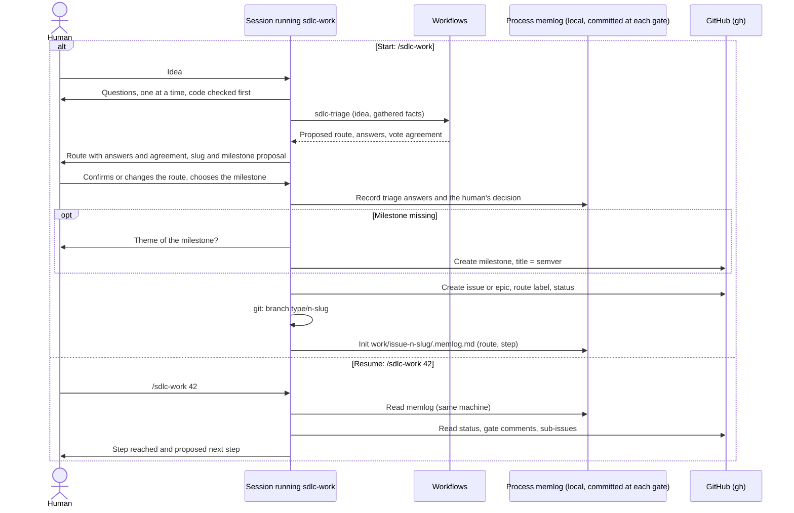
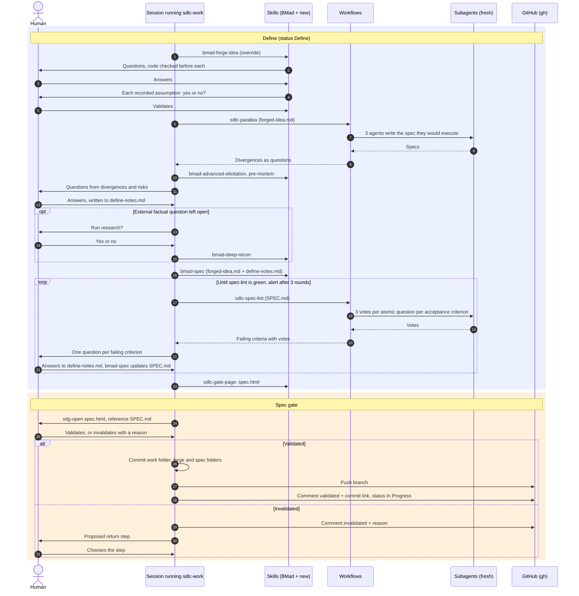
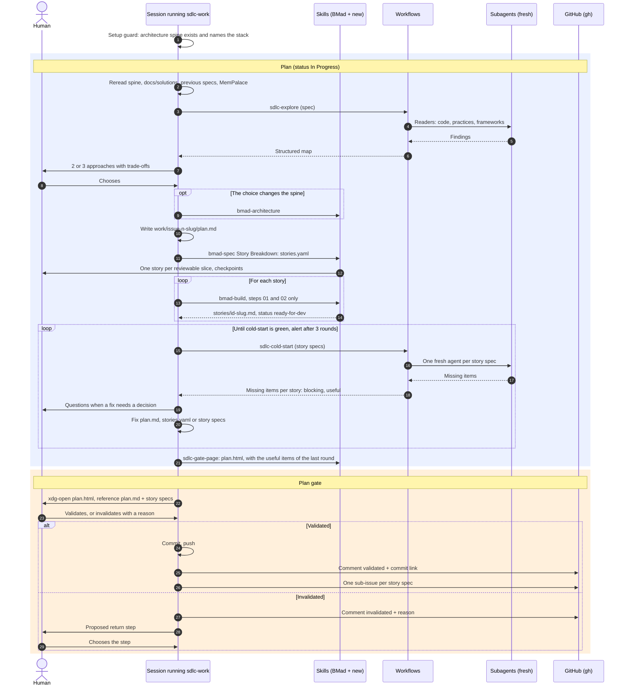
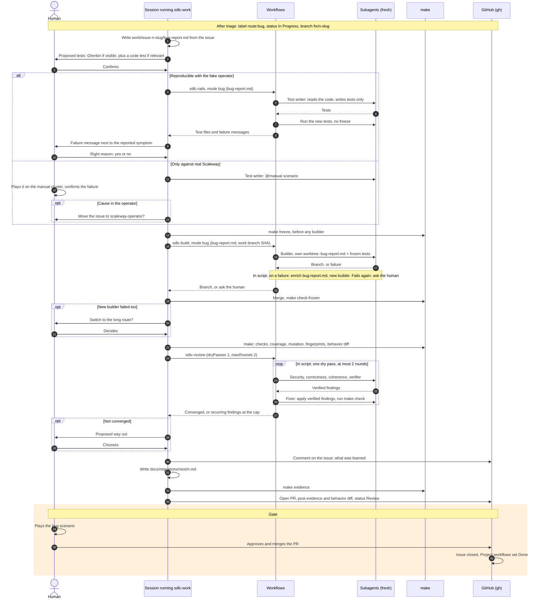
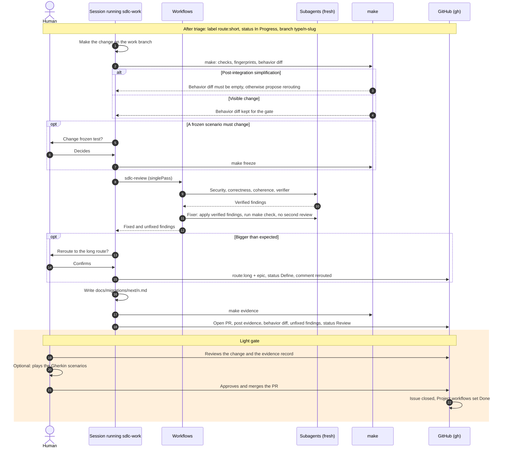

# Development process

How a piece of work goes from an idea to `main`, then to a release. Agents do the work; the human decides at the gates. Entry point: `/sdlc-work` in a Claude Code session.

The process skills load this file as a persistent fact: every line added here costs tokens in each of them.

## Building blocks

| Block | What it is | Talks with the human |
| --- | --- | --- |
| Session | The Claude Code conversation the human starts; it runs the skill `sdlc-work` | Yes |
| Skill | Instructions loaded by the session, which then plays that role: `sdlc-work`, `sdlc-gate-page` (module `mathieubodin-sdlc`) and BMad skills customized in `_bmad/custom/` | Yes (it is the session) |
| Workflow | A saved script in `.claude/workflows/`, run in the background, whose loops, votes and counters are code; it accepts no input mid-run and returns one result | No |
| Subagent | An agent with a fresh context, started by a workflow (or by the session for the `@manual` test writer of the bug route); works alone and returns a report | No |
| Command | A tool without AI: `make`, `git`, `gh` | No |

`sdlc-work` keeps every interaction with the human and launches a workflow between two of them. The BMad skills it calls (`bmad-forge-idea`, `bmad-deep-recon`, `bmad-spec`, `bmad-review`, `bmad-architecture`, `bmad-build`, `bmad-code-review`, `bmad-walkthrough`) load this file as a fact and, at their end, write their result to the process memlog and hand control back to `sdlc-work` (overrides in `_bmad/custom/<skill>.toml`). A memlog is active when the current branch is `{type}/{n}-{slug}` and `_bmad-output/work/issue-{n}-{slug}/.memlog.md` exists, so a skill run by hand on a work branch hands back too. `bmad-advanced-elicitation` offers no such override, and `bmad-build`, run for its steps 01 and 02 only during Plan, never reaches its completion step: for both, `sdlc-work` records the result itself. If the session drifted or stopped, `/sdlc-work <n>` resumes.

Workflows:

| Workflow | Used in | Returns |
| --- | --- | --- |
| `sdlc-triage` | Triage | Proposed route, answers, vote agreement |
| `sdlc-parallax` | Define | Divergences between 3 specs, as questions |
| `sdlc-spec-lint` | Define | Failing acceptance criteria, with votes |
| `sdlc-explore` | Plan | Map of the code, practices and frameworks |
| `sdlc-cold-start` | Plan | What each story spec is missing, blocking items apart |
| `sdlc-rails` | Rails | Long mode: tests frozen, suspect tests, failed stories; bug mode: each test's failure message |
| `sdlc-build` | Build | Finished builder branches, failed items |
| `sdlc-review` | Review | Converged, or the recurring findings at the cap |

Where a BMad skill does the same job by hand, its override in `_bmad/custom/<skill>.toml` is the single definition of the prompts: `sdlc-work` resolves it with `_bmad/scripts/resolve_customization.py` and passes the prompts to the workflow in `args`.

| Workflow | Manual equivalent | Override keys |
| --- | --- | --- |
| `sdlc-review` | `bmad-code-review` | `review_layers`, `sdlc_verifier_prompt`, `sdlc_fixer_prompt` |
| `sdlc-spec-lint` | `bmad-review` | `lenses` (entry `spec-lint`) |
| `sdlc-rails`, `sdlc-build` | `bmad-build` | `sdlc_test_writer_prompt`, `sdlc_bug_test_writer_prompt`, `sdlc_builder_prompt` |

## Routes

| Route | For | Label | Gates |
| --- | --- | --- | --- |
| short | A typo, a code simplification after integration | `route:short` | Light gate (the PR) |
| bug | A defect, bounded, no new behavior; no spec, no plan | `route:bug` | Gate (the PR) |
| long | A feature | `route:long` + `epic` | Spec gate, plan gate, delivery gate (the PR) |

### Triage

The session asks questions one at a time, checking the code first, then runs `sdlc-triage`. Each atomic question is answered by 3 independent agents; a rule in code combines the answers into a proposed route and reports the vote agreement as the uncertainty signal. The human confirms or changes the route. The answers, the proposed route and the human's decision are recorded in the process memlog, to adjust the questions later.

Triage questions and rule, decided with the author and defined once in `.claude/workflows/sdlc-triage.js` (`QUESTIONS`, `VOTES`, `MIN_YES`); `args` are the idea or issue text and the facts `sdlc-work` gathered:

1. `defect`: Does it describe an observed defect: something that should work and does not?
2. `newBehavior`: Does it add a new behavior the user can see or use?
3. `adoptionKeys`: Does it touch the adoption keys: the namespace name, the `scaleway.mathieubodin.io/project-id` annotation, custom resource names, an Instance's zone or Scaleway name, or the tags the operator sets on load balancers and secrets?
4. `data`: Does it change the content or the format of what the project exports or sends, or how Secrets are handled?
5. `smallChange`: Is it limited to a small edit: a typo, a wording, or a simplification that keeps the same behavior?

A question is "yes" with at least 2 "yes" out of 3 votes; a vote whose agent died counts as a missing "yes". The rule, in order: `newBehavior`, `adoptionKeys` or `data` yes gives long; otherwise `smallChange` gives short; otherwise `defect` gives bug; otherwise long, the safest route. The `data` question and the order of `smallChange` and `defect` were changed with the author after the first real runs: a typo is a defect too, and a deletion changes what is kept. The agreement is the number of unanimous questions; a split question is returned as uncertain when flipping its answer would change the route. Voters are read-only agents (`Explore`); the idea and the facts are quoted as data, the question before them.

At the same confirmation, `sdlc-work` proposes the issue title, the slug and, optionally, a milestone. A milestone that does not exist is created after confirmation: title checked as semver, theme asked and written in its description. An issue may have no milestone. Decided with the author: this one confirmation covers the GitHub writes that follow (issue or labels, milestone, board status); `sdlc-work` then creates the branch from `origin/main` and the memlog, and pushes nothing yet. The board is updated with `scripts/project-item.sh`.

### Rerouting

Work that turns out bigger than expected goes to the long route, on the human's confirmation: the same issue gets `route:long` + `epic` instead of `route:short` or `route:bug`, status Define, a comment `rerouted: <reason>`. Branch and memlog are kept, and the work done is an input to Define. The branch is renamed when its type changes (for example `fix/` to `feat/`).

## GitHub mapping

| Work | GitHub |
| --- | --- |
| Long work | Epic: parent issue labeled `epic` |
| Story of a long work | Native sub-issue of the epic, created after the plan gate, carrying its story spec |
| Short work or bug | Plain issue |
| Release | Milestone, titled with its semver version (for example `v0.3.0`) |

- One branch per work: `{type}/{n}-{slug}`, `type` the Conventional Commits type planned for the PR, `slug` derived from the issue title, kebab-case, at most 4 words. Example: `feat/27-yaml-export`.
- One PR per work, to `main`. No direct push to `main` (branch protection).
- The PR references every issue it closes: `Closes #<n>`, and for long work the epic first, then every sub-issue (CI reads the issue of the work from the first `Closes`).
- An issue opened by an external user is triaged with `/sdlc-work <n>`.

Project v2 (<https://github.com/users/mathieubodin/projects/4>) statuses:

| Status | Meaning |
| --- | --- |
| Backlog | Issue open, triage not started |
| Triage | Triage in progress, or finished with work not started (the route label tells them apart) |
| Define | Long work, until the spec gate |
| In Progress | Long work from Plan to the end of the review; short work and bugs right after triage |
| Review | PR open |
| Done | Issue closed or PR merged, set by the Project built-in workflows "Item closed" and "Pull request merged" |

`sdlc-work` sets every status except Done. Sub-issues follow the epic: In Progress when the build starts, Review when the PR opens, Done at the merge.

## Work folder

`_bmad-output/work/issue-{n}-{slug}/` holds the process files of one work:

| File | Content |
| --- | --- |
| `.memlog.md` | Process memlog: route, steps, triage answers, gate decisions, workflow runs, results of the called skills |
| `define-notes.md` | Long route: questions and answers from Parallax, Premortem and Research sections |
| `plan.md` | Long route: plan of this work |
| `cold-start.md` | Long route: useful items of the last cold-start round, rewritten by `sdlc-work` at each round, shown on `plan.html` |
| `bug-report.md` | Bug route: written from the issue at triage, enriched at each builder failure |
| `spec.html`, `plan.html` | Gate pages |
| `evidence.md` | Evidence record, rewritten by `make evidence` |
| `cost.json` | Token cost, written by `make cost` |

`SPEC.md`, `stories.yaml` and the story specs (`stories/{id}-{slug}.md`) stay where `bmad-spec` and `bmad-build` write them, `_bmad-output/specs/spec-{slug}/`, and are referenced from the memlog; `bmad-forge-idea` writes `forged-idea.md` to `_bmad-output/forge/<slug>/`. Everything in `_bmad-output/` is committed.

## Start and resume



On another machine the memlog is available from the last gate commit; without it, `sdlc-work` resumes from the last gate recorded on GitHub.

## Long route

### Define and spec gate

- `bmad-forge-idea` explores the problem, checks the code before each question, and has every recorded assumption validated by yes or no.
- `sdlc-parallax`: 3 fresh agents (decided with the author) each write, alone, the spec they would execute from `forged-idea.md`, reading the code it concerns; an agent compares the specs and returns every divergence as a question, with each reader's position. The specs stay in the run's transcript, under the reader numbers the result uses. The run stops when fewer than 2 specs were written. Each divergence comes with a proposed answer and is classified important (what the user sees or does, data, security, cost, acceptance) or detail; decided with the author: `sdlc-work` asks the important ones one at a time and shows the details as one list of proposed answers, validated or corrected together.
- Pre-mortem with `bmad-advanced-elicitation`: "three months from now the project failed, write the postmortem"; every risk becomes a question; `sdlc-work` writes the risks to `define-notes.md` itself.
- Answers go to `define-notes.md`. When it holds an external factual question without answer, `sdlc-work` proposes research (`bmad-deep-recon`); the human decides, and a skipped research is recorded.
- `bmad-spec` writes `SPEC.md` from `forged-idea.md` and `define-notes.md`, scope with non-goals and success signal included. Every acceptance criterion names its verification method.
- Spec-lint loop: `sdlc-spec-lint` asks each atomic question of each acceptance criterion to 3 independent agents; a criterion fails when the proportion of "yes" votes is below a threshold set in code. Each failing criterion becomes a question to the human, the answer goes to `define-notes.md`, `bmad-spec` updates `SPEC.md`, and spec-lint runs again. No gate page while it is red; alert to the human after 3 rounds. A manual `bmad-review` with the `spec-lint` lens asks the same questions once.

Spec-lint questions, decided with the author and defined once in `_bmad/custom/bmad-review.toml` (`spec_lint_questions`, used by the `spec-lint` lens and passed to `sdlc-spec-lint`):

1. Does this criterion say how we will verify that it is met?
2. Does this criterion have only one possible reading?

A criterion passes with at least 2 "yes" out of 3 independent votes for each question; a vote whose agent died counts as a missing "yes" (`.claude/workflows/sdlc-spec-lint.js`). A first trial on a two-criterion spec cost about 450,000 tokens for 13 agents.

### Gates

The spec gate and the plan gate work the same way:

- `sdlc-gate-page` renders an HTML page to help understand, from the reference files only, in English (decided with the author: the project rule applies), self-contained, with the sections listed in its `SKILL.md`; the Markdown stays the reference, and the decision validates or invalidates it.
- `sdlc-work` prints the absolute path of the page and runs `xdg-open`.
- Validated: commit of the work folder and the folders referenced by the memlog, push, comment `validated` on the epic with the commit link. This commit is also the resume point from another machine.
- Invalidated: comment `invalidated: <reason>`; `sdlc-work` proposes a return step from the reason (forge if the problem is ill-posed, parallax or pre-mortem if a risk is missing, `bmad-spec` or the plan if it is the writing); the human chooses.



### Setup guard

Setup runs once per project, manually, in a separate session with `bmad-architecture`. `sdlc-work` refuses to start Plan unless the architecture spine (`_bmad-output/planning-artifacts/architecture/`) exists and names the stack.

### Plan and plan gate

- Project memory reread: the architecture spine, `docs/solutions/`, previous `SPEC.md` files under `_bmad-output/specs/`, a MemPalace search in the `scaleway_manager` wing.
- `sdlc-explore`: parallel readers of the code (repository only), practices and frameworks (project rules and lessons first, then the web, decided with the author); each finding carries its source, a path or a URL; a reader that died is listed in `failed` and its section is `null`.
- 2 or 3 approaches with trade-offs; the human chooses. `bmad-architecture` is called only when the choice changes the spine.
- `sdlc-work` writes `plan.md`: explorations, approaches, choice, contracts at each boundary, sequential trunk and parallel leaves.
- Story Breakdown of `bmad-spec` writes `stories.yaml`; `bmad-build` then writes one story spec per story, steps 01 and 02 only, up to status `ready-for-dev` (`_bmad/custom/bmad-build.toml` forbids its shortcut that would code a small story directly). At its checkpoint `sdlc-work` answers "Approve and stop", except for a story marked `spec_checkpoint: true` in `stories.yaml`, which the human reviews; every story spec is reviewed again at the plan gate. `sdlc-work` commits each story spec before the next one (`bmad-build` stops on uncommitted changes) and passes any question `bmad-build` asks to the human, never answering it itself. It never runs `bmad-build` again on a `ready-for-dev` story during Plan: that would start the implementation.
- Cold-start loop: `sdlc-cold-start` gives each story spec alone to a fresh agent, as a builder will get it (the story spec, the files it names and the code, no other planning file; code from stories built before it and the frozen tests are taken as coming), which lists what it is missing, each item blocking (it would have to guess) or useful. Decided with the author: only blocking items, or an agent that died, keep the round red; the useful items of the last round, the green one, are listed on `plan.html`. Fixes go to `plan.md`, `stories.yaml` or the story specs, with questions to the human when needed. No gate page while it is red; alert after 3 rounds.
- After the plan gate: one sub-issue per story spec.



### Rails, build, review, delivery gate

- Rails: `sdlc-rails` starts one test writer per story, given the story spec only, never the code; every new test is then run: it must fail, since the code does not exist yet. Decided with the author: a test that already passes, or a file git already tracks, goes back once to a new writer for its story, who rewrites that same file; if it still passes, it is not frozen and is reported. Then a single `make freeze` of the failing tests and a commit on the work branch, for all stories before any build. `sdlc-work` shows the suspect tests and the stories left without tests to the human, who decides before the build. No other human check of the tests: a wrong test shows during the build or at the delivery gate.
- Build: `sdlc-build` starts one builder per story in its own worktree, with the story spec and the frozen tests, at most 3 at the same time (decided with the author); each builder commits on its worktree branch and returns the branch and commit, which another agent checks (commit at the tip of the branch, descending from the work branch SHA, no frozen test changed). First the trunk, merged by `sdlc-work`, then the leaves in parallel, merged one by one with `make check-frozen` after each. A story improved after a failure (`ticketImproved`, or a failed story) has its story spec edited in the work tree: `sdlc-work` commits it before merging. A builder that did not start from the work branch SHA returns `wrong base`, without the two-failure rule. Failed builders' worktrees are named in the result and kept for inspection.
- Verification: `make` runs the checks, coverage measured by a tool, mutation testing on the changed code (`MUTATION=0` switches it off), frozen tests.
- Review: `sdlc-review`, see [Review loop](#review-loop).
- Before the PR: `/ce-compound` records the lessons; MemPalace is updated; `sdlc-work` creates a `route:short` issue "simplify after #n" with the leads seen in review and, when recurring lessons exist, a "distill lessons" issue, both in Backlog; migration file; `make evidence`; behavior diff.
- Delivery gate: the PR. The evidence record, the behavior diff and the `/ce-compound` result are posted on it. The human plays the Gherkin scenarios (`bmad-walkthrough` as an aid), then approves and merges: the merge is the decision.

```mermaid
sequenceDiagram
    autonumber
    actor H as Human
    participant W as Session running sdlc-work
    participant K as Skills (BMad + new)
    participant F as Workflows
    participant A as Subagents (fresh)
    participant T as make
    participant G as GitHub (gh)

    rect rgba(120, 200, 140, 0.15)
    Note over H,G: Rails, build, verification, review
    W->>F: sdlc-rails, mode long (story specs)
    F->>A: One test writer per story: story spec only, no code
    A-->>F: Gherkin features, code tests
    F->>A: Run each new test: it must fail; one rewrite if it passes
    F->>A: Run make freeze, no human check
    F-->>W: Tests frozen, suspect tests, failed stories
    W->>W: Commit tests and fingerprint manifest
    W->>G: Sub-issues In Progress
    loop Trunk run, then leaves run
        W->>F: sdlc-build, mode long (story specs, work branch SHA)
        F->>A: One builder per story, own worktree: story spec + frozen tests
        A-->>F: Branch, or failure
        Note over F,A: In script, on a failure: improve the story spec, new builder. Fails again: back to Plan
        F-->>W: Finished branches, failed stories
        W->>T: Merge one by one, make check-frozen after each
    end
    W->>T: make: checks, coverage, mutation, fingerprints
    W->>F: sdlc-review (dryPasses 2, maxRounds 5)
    loop In script: until two dry passes with 3 lenses, at most 5 rounds
        F->>A: Security, correctness, coherence, verifier
        A-->>F: Verified findings
        F->>A: Fixer: apply verified findings, run make check
    end
    F-->>W: Converged, or recurring findings at the cap
    opt Not converged after 5 rounds
        W->>H: Recurring findings: back to Plan, back to Define, or accept and list in PR
        H->>W: Chooses
    end
    W->>K: /ce-compound
    W->>W: Update MemPalace
    W->>G: Issues simplify after n and distill lessons, Backlog
    W->>W: Write docs/migrations/next/n.md
    W->>T: make evidence, behavior diff
    W->>G: Open PR, Closes epic + all sub-issues
    W->>G: Post evidence, behavior diff, lessons, status Review
    end

    rect rgba(255, 180, 80, 0.2)
    Note over H,G: Delivery gate
    H->>H: Plays the Gherkin scenarios (bmad-walkthrough as aid)
    H->>G: Approves and merges the PR
    G->>G: Issues closed, Project workflows set Done
    end
```

## Bug route

- `sdlc-work` writes `bug-report.md` from the issue; the user's issue is never edited.
- Tests proposed by `sdlc-work` and confirmed by the human: a Gherkin scenario when the bug is visible in the UI, plus a code test when relevant; a code test only otherwise.
- `sdlc-rails` in bug mode: the test writer reads the code (it needs the entry points) and writes tests only; the new tests are run, not frozen.
- `sdlc-work` shows each test's failure message next to the reported symptom; the human confirms the reason. Then `make freeze`, before any builder, so that no builder can weaken the bug tests.
- A bug that only shows against real Scaleway: first try to reproduce it with the fake operator; otherwise a `@manual` scenario that the human plays before and after the fix; if the cause is in the operator, `sdlc-work` proposes moving the issue to `scaleway-operator`.
- `sdlc-build` in bug mode: after two failures, the human is asked whether to switch to the long route.
- Review: `sdlc-review` with 1 dry pass, at most 2 rounds.
- Before the PR: a comment on the issue summarizing what was learned, migration file, `make evidence`.



## Short route

- The session makes the change itself on the work branch, without a subagent.
- Behavior diff: must be empty for a post-integration simplification, otherwise `sdlc-work` proposes rerouting; for a visible change it is posted on the PR, and the merge accepts it as the new reference.
- A frozen scenario that must change needs the human's decision, then `make freeze`.
- Review: `sdlc-review` with a single pass; verified findings are fixed and `make check` runs again, without a second review; unfixed findings are listed in the PR.
- Light gate: the human reviews the change and the evidence record, plays the Gherkin scenarios only if the change looks bigger than expected, then merges.



## Rules

### Frozen tests

Tests are frozen by detection, not by a lock. `make freeze FILES="..."` records the sha256 of the given test files (code tests and Gherkin features) in `frozen-tests.sha256`, replacing their entries and keeping the others. `make check-frozen` fails when a frozen file changed or disappeared. New tests are frozen without a human decision on the long route (by `sdlc-rails`, or by a manual `bmad-build`), and after the human confirms their failure reason on the bug route. Changing a frozen test always needs the human's decision, then `make freeze`.

### Manual use of `bmad-build`

Run by hand on one story at `ready-for-dev`, `bmad-build` follows the same order as the workflows: a subagent writes the tests from the story spec without seeing the code, `make freeze` protects them and they are committed, then another subagent writes the code (`sdlc_test_writer_prompt` and `sdlc_builder_prompt` in `_bmad/custom/bmad-build.toml`, shared with `sdlc-rails` and `sdlc-build`; `sdlc_bug_test_writer_prompt` there serves the bug mode of `sdlc-rails`). Its built-in review is off: it stops with "no active review layers", and the review is done with `bmad-code-review`.

### Two-failure rule

A builder that fails is stopped; an agent improves the ticket (the story spec, or `bug-report.md`) and a new builder starts. If it fails too: long route, back to Plan and its gate; bug route, the human decides whether to switch to the long route. No switch to a more powerful model. `sdlc-build` enforces the rule in code.

### Parallel builders

Each builder runs in its own git worktree, at most 3 at the same time. Worktrees start from the current `HEAD` because `.claude/settings.json` sets `"worktree": {"baseRef": "head"}` (by default they start from `main`). Each builder also checks that its `HEAD` starts with the work branch SHA passed by `sdlc-work` and stops otherwise, so `sdlc-work` makes no commit while `sdlc-build` runs. `sdlc-build` returns the branches; `sdlc-work` merges them one by one with `make check-frozen` after each.

### Review loop

Lenses security, correctness and coherence, defined as `review_layers` in `_bmad/custom/bmad-code-review.toml` (the four default layers are off). Each lens works in two phases: triage first (where to look), then findings read in the files. Coherence covers the string constants between code and docs, and the actual content of security and config files.

Each round of `.claude/workflows/sdlc-review.js`: an agent writes the diff of the working tree since the base SHA, untracked files included, to a folder outside the repository (`scripts/review-diff.sh`, which refuses a path inside it); the lenses review it in parallel; a verifier (`sdlc_verifier_prompt`) checks every finding in the code, grades the real ones and matches them with those of earlier rounds; a fixer (`sdlc_fixer_prompt`) fixes the verified ones in the working tree, without committing, and runs `make check`. A verified finding whose fix needs a decision is set aside for the human. A round is dry when every lens answered, every finding got a verdict and no new verified finding remains (decided with the author: false alarms do not count). The workflow returns whether it converged, every verified finding with its status (`fixed`; `unfixed`, with the reason; `open` when the fixer gave no answer; `not found again` for an open finding no later round reported), the list of those not `fixed`, the recurring ones, the fixes of the last round that no round reviewed, and the fixer's last `make check` result; `sdlc-work` runs `make check` again before committing the fixes. A manual `bmad-code-review` runs the same lenses once, and its own triage step verifies each finding: a verifier cannot be a layer, because layers run in parallel. On uncommitted changes it diffs with `git diff HEAD`, which leaves out untracked files: run `git add -N <file>` on new files first.

| Route | `sdlc-review` arguments | At the cap |
| --- | --- | --- |
| long | `dryPasses` 2, `maxRounds` 5 (2 dry rounds in a row) | Back to Plan, back to Define, or accept and list the findings in the PR; the human chooses |
| bug | `dryPasses` 1, `maxRounds` 2 | Way out proposed; the human chooses |
| short | `singlePass` | Unfixed findings listed in the PR |

A loop that does not converge signals a contradictory spec or a bad split.

### Testing without Scaleway

- No automated test may cause cost at Scaleway; automated tests never leave the local machine.
- A fake local operator, used only by automated tests, writes the CR `status` (Pending, Syncing, Synced, Error, TerminationBlocked) without calling Scaleway. The real operator is not installed in the test cluster.
- Gherkin scenarios tagged `@manual` touch real Scaleway: never run automatically, played by the human. The others run automatically against the fake operator.
- A `make` target run by the human builds the image and the Helm chart, creates a kind cluster and installs the real operator and the local chart, for manual tests. It runs no scenario.
- The fake operator may drift from the real one; `@manual` scenarios remain the reality check.

### Behavior diff

It covers the rendered UI, not the backend API. Gherkin scenarios are replayed in a browser before and after the change (playwright-bdd, ARIA snapshots as the main capture); the accepted capture becomes the reference. It runs locally, not in CI.

## Migration files

Every PR adds or changes `docs/migrations/next/<n>.md`, `<n>` being the issue number (the epic for long work), one file per issue so that parallel PRs do not conflict. The folder holds nothing else: "Deliver" reads its files. A change without impact contains exactly:

```text
Migration: no impact
```

Otherwise the file describes both directions, each section with text:

```markdown
# Migration for #42

## Upgrade

Steps to go from the previous version to this one.

## Rollback

Steps to go back to the previous version.
```

`make check-migration ISSUE=<n>` (`scripts/check-migration.sh`) fails when the file has another content, or when it is not added or changed by the commits of the branch since it left `main` (`git merge-base origin/main HEAD`; `BASE=<ref>` replaces `origin/main`). So a file inherited from an earlier PR of the same issue, or changed on `main` by another PR, does not count, and uncommitted changes are not seen, as in CI. In CI, `<n>` comes from the first `Closes #<n>` of the PR body outside HTML comments (`scripts/pr-issue.sh`), and the checkout needs the history down to the merge-base (`fetch-depth: 0`). Files are never moved after a release: "Deliver" reads only those changed since the previous tag.

## Evidence record

`make evidence ISSUE=<n>` (`scripts/evidence.sh`) replays the checks and rewrites the whole `evidence.md` of the work folder, whoever runs it: `lint-docs`, `lint-workflows`, `test-workflows`, `check-frozen`, `check-migration ISSUE=<n>`, plus the checks of U12 to U14 once they exist (the record lists what was not run). Every check runs even after a failure, and the target fails at the end if one did.

- Each check's full output is kept, colors removed and durations replaced by `<t>`: two runs on an unchanged tree differ only by the "Generated at" line.
- The record names the branch, the commit and whether the working tree had uncommitted changes; the exit code shown for a check is that of `make`.
- It ends with the summary of `cost.json`: `Tokens`, then the four categories per step and per model, and the unattributed share. It does not run `make cost`.

## Workflow tooling

Node tooling (Biome, oxlint, oxfmt, c8, markdownlint-cli2) is pinned in `package.json` and `package-lock.json`; install it once per clone with `npm ci`. `overrides` forces `smol-toml` 1.9.0: `markdownlint-cli2` 0.23.3 pins 1.8.0, which `npm audit` reports (denial of service on a crafted TOML file; markdownlint-cli2 only parses TOML for a `.toml` configuration, which this project does not have). Remove the override once a `markdownlint-cli2` release depends on a fixed `smol-toml`. The other advisories `npm audit` reports (`braces` and its chain, `katex`) have no fixed version; they are denials of service on crafted input, and the tools only read this repository.

| Files | Tool | Configuration |
| --- | --- | --- |
| Workflow scripts: `.claude/workflows/*.js`, `tests/workflows/fixtures/*.js` | oxlint (lint), oxfmt (format) | `.oxlintrc.json`, `.oxfmtrc.json` |
| Harness and tests (`tests/workflows/*.js`), JSON files | Biome | `biome.json` |
| Coverage of the workflow scripts | c8 | `.c8rc.json` |

- `make lint-workflows` checks, `make fix-workflows` fixes then checks, `make test-workflows` runs the tests with coverage and fails below 100 % (branches, lines, functions, statements) of the workflow scripts: their logic is small and fully driven by fake hooks.
- Why two tools: a workflow script returns its result with a top-level `return`. Biome cannot parse it and has no option for it; ESLint forces it off for ES modules with its default parser. The oxc parser (oxlint, oxfmt) always accepts it. Hooks provided by Claude Code (`agent`, `parallel`, `pipeline`, `phase`, `log`, `args`, `budget`, `workflow`) are declared as globals in `.oxlintrc.json`, so that `no-undef` catches anything else, Node APIs included. `.oxfmtrc.json` sets the line width to 80, as Biome; the other defaults already match.
- Harness: `tests/workflows/harness.js` runs a workflow script in a fresh V8 context with fake hooks. `runWorkflow(path, { args, respond, budget, workflow })` calls `respond({ prompt, opts, index })` for each `agent()` call and returns the script's result, its `meta`, the agent calls, phases and logs. A `respond` that throws makes that `agent()` return `null`, as a subagent that died; a thunk or stage that throws yields `null` in `parallel` and `pipeline`. `budget.total` is the `budget` option, nothing is spent; `workflow()` calls the `workflow` option. `Date.now()`, `Math.random()`, `Date()` and `new Date()` without argument throw. The script must begin with `export const meta =`; the harness does not check that `meta` is a pure literal. Result and `meta` must be plain data (cloned with `structuredClone`). Errors and coverage point to the lines of the source file.
- Saved workflows are read from `.claude/workflows/`: tests and fixtures live in `tests/workflows/`, never there.
- A workflow saved during a session is found by name only from the next session; until then it is launched by its file path.

## CI

On every PR, `pr-checks.yml` runs `make lint-docs`, `make lint-workflows`, `make test-workflows`, `make check-frozen` and `make check-migration`, with `<n>` read from `Closes #<n>` in the PR body (the check fails without it); `<n>` is the issue of the work, the epic for long work. The jobs are required status checks of `main`, with `conventional-title` (PR title in Conventional Commits form).

Locally, prek runs the same `make` targets on every commit. Install it once per clone with `prek install`; when a global `core.hooksPath` is set, `prek install` refuses, and `prek install --git-dir "$(git rev-parse --absolute-git-dir)"` is used instead. `make help` lists the targets; `make check` runs the four checks that need no issue number (`lint-docs`, `lint-workflows`, `test-workflows`, `check-frozen`).

## Release

- Versions follow semver. No published version is ever removed: a faulty version is fixed by a patch.
- The "Deliver" workflow (`.github/workflows/deliver.yml`) has two triggers: milestone closed (version = milestone title, so a milestone title is always a version) and "Run workflow" (`workflow_dispatch`, the human types the tag). A patch release needs no milestone. The milestone trigger runs it from `main`; a run started on another branch stops.
- It checks (`scripts/release-check.sh`) that the version is valid semver with a leading `v` (`v1.2.3`, `v1.2.3-rc.1`), that the tag does not exist and that the milestone of that title, if any, has no open issue; nothing is created before these checks pass. It then creates the tag and the GitHub release on the commit that triggered it. Building and publishing the image and the Helm chart (OCI, `oci://ghcr.io/<owner>/charts`) to ghcr.io come once the stack is chosen. A `concurrency` group makes a second delivery wait for the first; a third one cancels the waiting one. "Run workflow" publishes from `main` only, and a version with a `-` (`v1.2.3-rc.1`) is marked as a prerelease.
- Release note (`scripts/release-note.sh`, previewed with `make release-note`): from the `docs/migrations/next/` files added, changed or renamed since the previous version (all of them when no tag exists). For a final version the previous version is the previous final one: `v0.3.0` lists everything since `v0.2.0`, `v0.3.0-rc.1` included (decided with the author); a prerelease lists what changed since the latest tag. Only no-impact entries: a single "No impact." line; otherwise the no-impact entries are dropped and each other entry appears under its issue number. The command that reinstalls the previous version is added with the image and chart publishing.

## Token cost

`sdlc-work` records each step's start and end, and every workflow run, in the process memlog. `make cost ISSUE=<n>` attributes the tokens of the main session, subagents and workflow runs to the steps of the work, writes `cost.json` to the work folder, and prints the value written to the Project `Tokens` field (input + output + cache creation). It runs before every commit `sdlc-work` makes and at every resume. The epic carries the `Tokens` total; sub-issues have none. The evidence record and the PR body carry a summary of `cost.json`. `make cost-report` aggregates every work per route and step. Format, attribution rules and limits: [token-cost-tracking.md](token-cost-tracking.md).

## Installing the process module

The module `mathieubodin-sdlc` is versioned in the repository, in the layout documented by BMad Builder for a multi-skill module: `.claude-plugin/marketplace.json` lists the skills under `skills/`; the setup skill `mathieubodin-sdlc-setup` carries `assets/module.yaml` and `assets/module-help.csv`. Workflows are not part of the module.

Install it, and reinstall it after any change under `skills/`, from the project root:

```bash
npx bmad-method@6.12.4 install --directory "$PWD" --custom-source "$PWD" --tools claude-code --yes
```

- The installer copies the skills to `.claude/skills/` and merges the module rows into `_bmad/_config/bmad-help.csv`, which is never edited by hand. Commit what it changed.
- Always pass `--custom-source`: on 6.12.4, an update without it fails for local custom modules (BMAD-METHOD issue #2869).
- Edit the module in `skills/`, never its installed copies in `.claude/skills/` and `_bmad/mathieubodin-sdlc/module-help.csv`.
- `_bmad/_config/manifest.yaml` records the module with the absolute `localPath` of the machine that installed it; a reinstall on another machine rewrites it.
- `uv run .claude/skills/bmad-module-builder/scripts/validate-module.py skills` checks the module structure.
