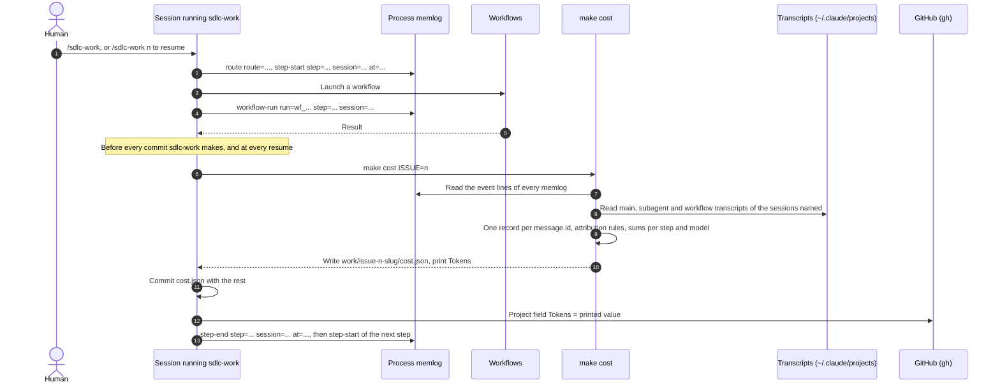

# Token cost tracking

How much each piece of work costs in tokens, per process step and per route. There is no budget: the figures are read afterwards to see where tokens go.

## What is measured

Claude Code writes one transcript per session under `~/.claude/projects/<repository path, "/" and "." replaced by "-">/`:

| File | Content |
| --- | --- |
| `<session>.jsonl` | The main session |
| `<session>/subagents/agent-*.jsonl` | Subagents started by the session |
| `<session>/subagents/workflows/<runId>/agent-*.jsonl` | Agents of one workflow run |

Each model response is a line of type `assistant` carrying `message.id`, `message.model`, `timestamp` and `message.usage`. A response is written once per content block, with the same `message.id` and the same usage: lines are counted once per `message.id`.

Four categories are kept per model: `input`, `output`, `cacheCreation` (`cache_creation_input_tokens`) and `cacheRead` (`cache_read_input_tokens`).

`Tokens` = `input` + `output` + `cacheCreation`, all models, attributed to a step of the work. It is the value written to the `Tokens` field of Project v2 and printed by `make cost`. Cache reads are reported but not included.

## The ledger: the process memlog

Each piece of work has a process memlog, `_bmad-output/work/issue-{n}-{slug}/.memlog.md`, written by `sdlc-work` through `_bmad/scripts/memlog.py append --type event`. Lines used for attribution have the form:

```text
- (event) <keyword> <key>=<value> <key>=<value> ...
```

Values contain no space; `at` is UTC and ends with `Z` (fractional seconds allowed), otherwise `make cost` stops and names the line. Keys other than those below are ignored, and so is any other line of the memlog.

| Keyword | Keys | Meaning |
| --- | --- | --- |
| `route` | `route` (`short`, `bug`, `long`) | Route chosen at triage |
| `step-start` | `step`, `session`, `at` (UTC, ISO 8601) | A step starts in a session |
| `step-end` | `step`, `session`, `at` | That step ends |
| `workflow-run` | `run`, `step`, `session` | A workflow run launched during a step |
| `session` | `step`, `session` | A whole session, with its subagents and workflow runs, belongs to a step (epic #2 bootstrap only) |

Steps:

| Route | Steps, in order |
| --- | --- |
| long | `triage`, `define`, `plan`, `rails`, `build`, `review`, `deliver` |
| bug | `triage`, `rails`, `build`, `review`, `deliver` |
| short | `triage`, `change`, `review`, `deliver` |
| epic #2 only | `bootstrap` |

- A gate is counted in the step it closes (spec gate in `define`, plan gate in `plan`).
- `deliver` covers `/ce-compound`, MemPalace, the migration file, the evidence record, the PR and the fixes made after it is opened.
- A resume (`/sdlc-work <n>`) opens a new `step-start` for the step resumed, in the new session.
- A `step-start` ends at the next `step-start` or `step-end` of the same session, in any memlog, or never (end of transcript) when the session stopped. Starting work 8 in a session therefore closes the open step of work 7. Each work's memlog lives on its own branch, and `make cost` reads only the memlogs of the current checkout: `sdlc-work` therefore writes the `step-end` of the open step of work 7 before starting a step of work 8 in the same session, so that each memlog closes its own windows.

## Attribution rules

`make cost ISSUE=<n>` reads every memlog under `_bmad-output/work/`, then puts each message of the sessions named by memlog `<n>` in the first case that applies. In each case, when the line found belongs to another memlog, the message belongs to another work and is not counted here.

1. The session has a `session` line: its step.
2. The message belongs to a workflow run declared by a `workflow-run` line: its step.
3. Its timestamp falls in a step window of this session: that step.
4. The next window of this session is a `triage`: that `triage` (what precedes triage belongs to the issue it creates).
5. Otherwise: `unattributed`, reported apart, outside `Tokens`, to show how much the ledger misses.

When this memlog and another one both match a case, this memlog's line wins. Windows of all memlogs close one another (see above), so a message is counted at most once across all works, as long as no session and no run is declared in two memlogs.

## Where `make cost` runs and who runs it

`sdlc-work`, in the human's session, runs `make cost ISSUE=<n>` before every commit it makes and at every resume, then writes the printed value to the Project `Tokens` field. Workflows and subagents never run it: their transcripts are read afterwards. The human can run `make cost` or `make cost-report` at any time.



Where these runs fall in the process sequences (`docs/development-process.md`):

| Route | `make cost` before these `sdlc-work` commits | Step |
| --- | --- | --- |
| all | Resume `/sdlc-work <n>` (no commit; the PR and `Tokens` are updated) | step resumed |
| long | Spec gate validated: commit of the work, forge and spec folders | `define` |
| long | Plan gate validated: commit of `plan.md`, `stories.yaml`, story specs | `plan` |
| long | Tests and fingerprint manifest after `sdlc-rails` | `rails` |
| long | Each builder branch merged, trunk then leaves | `build` |
| long | Review result in the memlog | `review` |
| long | Migration file and evidence record, before the PR; each fix after it | `deliver` |
| bug | Tests frozen after the human confirms the failure reason | `rails` |
| bug | Builder branch merged | `build` |
| bug | Review result in the memlog | `review` |
| bug | Migration file and evidence record, before the PR; each fix after it | `deliver` |
| short | The change | `change` |
| short | Review fixes | `review` |
| short | Migration file and evidence record, before the PR; each fix after it | `deliver` |

`make evidence` copies the totals of `cost.json` into the evidence record, and the PR body carries the same summary.

## Output: `cost.json`

Written to the work folder and committed with the work, so the figures survive the squash merge and the purge of transcripts.

```json
{
  "issue": 7,
  "route": "long",
  "tokens": 11100111,
  "totals": {
    "steps": {"define": {"<model>": {"input": 0, "output": 11100100, "cacheCreation": 0, "cacheRead": 0}}, "triage": {"...": "..."}},
    "models": {"<model>": {"input": 0, "output": 11100111, "cacheCreation": 0, "cacheRead": 0}},
    "unattributed": {}
  },
  "sessions": {"<session id>": {"computedAt": "...", "steps": {"...": "..."}, "unattributed": {}}},
  "runs": {"wf_a": {"session": "<session id>", "step": "define", "computedAt": "...", "models": {"...": "..."}}}
}
```

- `sessions` holds the messages outside workflow runs, plus every unattributed message; `runs` holds the attributed messages of workflow runs, keyed by run id. `totals` and `tokens` are recomputed from both on every run.
- A session entry, and the runs of that session, are recomputed only when the session's main transcript is present. Otherwise the stored entries are kept unchanged: a run on another machine, or after the 30-day purge, loses nothing. Entries of a session no longer named by the memlog are dropped.

## Example

One session `S1` touches two works. Memlog of issue 7:

```text
- (event) route route=long
- (event) step-start step=triage session=S1 at=2026-10-18T10:00:00Z
- (event) step-start step=define session=S1 at=2026-10-18T10:10:00Z
- (event) workflow-run run=wf_a step=define session=S1
- (event) step-end step=define session=S1 at=2026-10-18T10:20:00Z
```

Memlog of issue 8:

```text
- (event) route route=short
- (event) step-start step=triage session=S1 at=2026-10-18T10:30:00Z
```

Messages of `S1` (output tokens chosen to show where each one lands):

| Message | Output | Issue 7 | Issue 8 | Rule |
| --- | --- | --- | --- | --- |
| Main, 09:50 | 1 | `triage` | | 4 |
| Main, 10:05 | 10 | `triage` | | 3 |
| Main, 10:15, written twice | 100 | `define`, once | | 3 |
| Subagent, 10:16 | 10000000 | `define` | | 3 |
| Run `wf_b` (not declared), 10:12 | 1000000 | `define` | | 3 |
| Main, 10:25 | 1000 | | `triage` | 4 |
| Main, 10:35 | 10000 | | `triage` | 3 |
| Run `wf_a`, 10:40 | 100000 | `define` | | 2 |

`make cost ISSUE=7` prints `11100111`; `make cost ISSUE=8` prints `11000`; together they hold every message once.

Epic #2 was measured afterwards with `session` lines only (step `bootstrap`), in `_bmad-output/work/issue-2-sdlc-process/`.

## Reading `make cost-report`

`make cost-report` reads every `_bmad-output/work/*/cost.json` and prints two Markdown tables:

- Per work: issue, route, `Tokens`, unattributed tokens, attributed cache reads. A high unattributed share means the ledger missed part of the sessions.
- Per route and step: number of works, the four categories and `Tokens`, summed. Divide by the number of works for an average per step.

## Limits

- Transcripts are local to the machine and deleted after `cleanupPeriodDays` (30 days by default). `make cost` must run on the machine of the session before that; the committed `cost.json` keeps the result.
- Only transcripts of this repository's project folder are read: a session started from another directory, a separate worktree for example, is not found.
- The commit trailers `Claude-Tokens-Delta` and `Claude-Tokens-Total` of the global `claude-token-tracking` hooks do not match `cost.json`: they read the main transcript only and count every line, without grouping by `message.id`.
